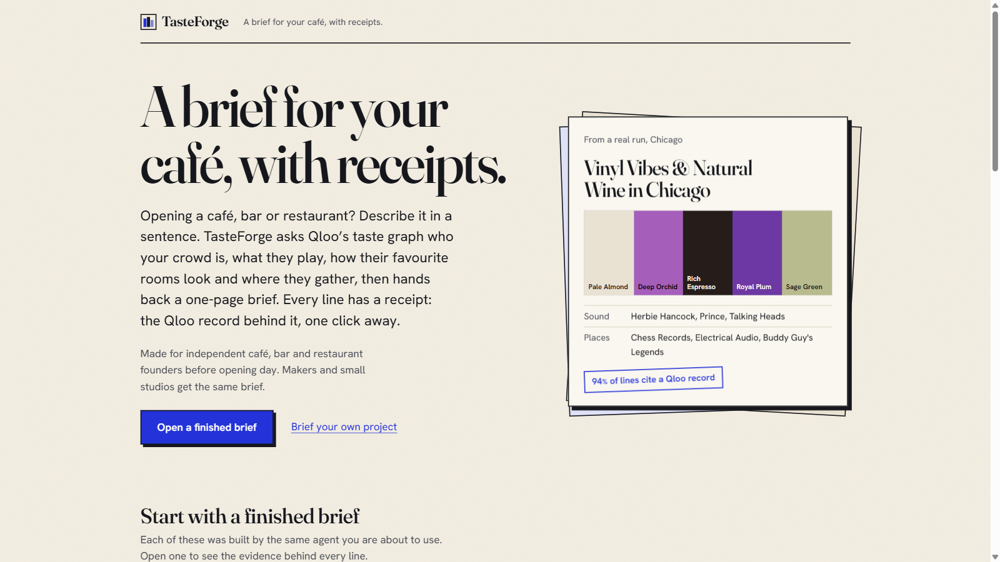

# TasteForge

**A brief for your café, with receipts.** Before you sign the lease, TasteForge asks Qloo's taste graph who your crowd is, what they play, how the rooms they love look and where they gather. Every song, colour and place in the brief is a real Qloo result you can click.

**Try it: https://tasteforge-fa98.onrender.com** (open a finished showcase brief; no wait) | Built for the Qloo Agentic Hackathon | MIT



- **Finds your crowd and reads the rooms they love.** Describe the place in a sentence and name a city. Qloo returns the audience's music, films and brands, the local places they like, and the neighbourhoods where they cluster.
- **Designs from real places.** The palette, lighting and materials come from the tags (decor and ambience first, then genre and cuisine) Qloo attached to real local places this audience likes, each swatch captioned with its tags.
- **Hands you a Monday list.** A playlist, a palette PNG, three rooms to visit, a menu idea built from Qloo's tags (or a brand collab), three copy lines and the neighbourhoods for flyers.

Made for independent café, bar and restaurant founders before opening, and the interior designers who brief them.

## Why not just ask ChatGPT?

In our 20-prompt, 5-city benchmark, **Qloo couldn't verify 30% of a plain LLM's 276 picks** in the requested city (26% of its places). We sorted the 84 misses with AI assistance (judgement from general knowledge, not a per-name check): **10 likely invented, 54 real but not in Qloo or listed under another type** (authors named as artists, for example), **15 only in another city**, 5 unclassified. So the problem isn't that the chatbot invents most things. The problem is that you can't tell which picks are real, local and checkable. TasteForge's rate is 0% of 312 picks. That's by construction: it can only return what Qloo returned. On audience fit, the two roughly agree, and we don't claim a fit advantage. (Method: 20 prompts across Indore, London, Brooklyn, Chicago and Paris, each checked against live Qloo on 2026-10-21; one day and one model, so indicative.)

Every brief runs the same check live: **Taste Proof** asks a plain LLM the same question and shows which of its picks Qloo could verify.

## What's in a brief

| Section | Contents |
|---|---|
| The audience | What they love (films, shows, other taste signals), with age and gender skew as context only |
| The look | A 4 to 5 colour palette derived in code from the decor, ambience, genre and cuisine tags in the brief's evidence (a documented tag-to-colour mapping, weighted by tag score and by how specific each tag is to the top places against the city baseline), named by the model and captioned with its tags; lighting, materials and reference places from the same tags |
| The sound | Artists the audience over-indexes on, with the query weighted toward people in the city (marked "local"; this means local listeners, not necessarily local artists), with trending direction |
| Pairings | Brands, plus menu ideas that may only use words from Qloo's cuisine tags |
| Where they are | Neighbourhood hotspots in your city on a map (needs a city) |
| How to talk to them | Tone and phrases, each citing evidence |
| Taste Proof | A plain LLM's answer to the same prompt, each pick checked against Qloo |
| Monday list | Six actions taken from the brief; download, print or copy |

Two entry points: **I know my audience** (you name artists, brands, tastes) and **Find my audience** (you describe what you make and the agent works out whose taste fits it).

What you can check, and what else it does:

- **Why buttons.** Every item opens the Qloo call behind it in an evidence drawer: the entities and tags it returned, with scores, and the raw query.
- **Citation coverage** (`groundingScore` in the code). The share of submitted items that cite a real Qloo record, computed by code. Uncited items are removed and listed. It checks that a citation exists, not that every caption is true.
- **Refine.** Like, dislike or lock items. Only the affected sections are re-walked, with dislikes sent to Qloo as exclusions and likes added as signals.
- **Showcase briefs.** Six example briefs (Chicago, Indore, New York, Paris, Brooklyn, London) are built on the server after boot, so a judge can open one instantly. `npm run warm` waits until they are ready.
- **Two-city comparison.** The same audience in a second city, reusing the resolved seeds (no Taste Proof).
- **Shareable `/b#...` links.** The brief travels in the URL fragment. The server signs the evidence it issues, and a shared page shows "Shared link, verified" or "unverified", so an edited link cannot pass for Qloo data.

## How it uses Qloo

Qloo chooses every artist, place, brand, hotspot and style tag in a brief. A language model writes the colour names, captions, listening direction, menu wording and copy lines around that evidence; code removes anything that cites no Qloo record, and a menu idea may only use words that appear in Qloo's tags or names. Artist, brand, film and TV queries carry `signal.location.query` for the requested city, so picks are weighted toward local people (the UI marks them "local").

| Qloo endpoint | Used for | Where (under `src/lib/agent/`) |
|---|---|---|
| `GET /search` | Resolve names the user mentions (artists, brands, places, films) to Qloo entity ids. Ambiguous matches become a "which did you mean?" question instead of a guess. Also resolves the baseline LLM's picks for Taste Proof. | `pipeline/resolve.ts`, `proof.ts` |
| `GET /v2/tags` | Turn concept phrases ("slow living", "japanese ceramics") into Qloo tag ids that act as taste signals. Required for Find my audience mode. | `pipeline/resolve.ts` |
| `GET /v2/insights` with `filter.type` = `artist`, `movie`, `tv_show`, `brand` | Audience affinities, the sound, brand pairings, using entities and tags as `signal.interests.*`. `feature.explainability` is available on the query builder. | `pipeline/walk.ts` |
| `GET /v2/insights` with `filter.type=place` and `filter.location.query` | Places the audience likes in the chosen city; the top five feed the aesthetic and cuisine lookups. | `pipeline/walk.ts` |
| `GET /v2/insights` with `filter.type=urn:tag` | Tag analysis of those top places, restricted to `urn:tag:decor:qloo` and `urn:tag:ambience:qloo` (look) and `urn:tag:genre:place:restaurant` (menu ideas). | `pipeline/walk.ts` |
| `GET /v2/insights` with `filter.type=urn:demographics` | Age and gender skew of the audience. | `pipeline/walk.ts` |
| `GET /v2/insights` with `filter.type=urn:heatmap` | Where the audience concentrates in the city, by neighbourhood boundary. | `pipeline/walk.ts` |
| `GET /v2/trending` | Whether the top artists are rising in popularity. | `pipeline/walk.ts` |
| `GET /v2/insights` with `filter.results.entities` | Taste Proof: Qloo ranks a supplied shortlist (the baseline LLM's picks and TasteForge's picks) against the same signals. | `proof.ts` |
| `GET /v2/insights` with `filter.exclude.entities` / `filter.exclude.tags` | Refine loop: keep disliked items out of the re-walk. | `refine/`, `pipeline/walk.ts` |

The critic step can also re-issue insight queries with the city dropped, only tags, only entities, or more results when a section comes back thin. All request builders are pure functions with tests that assert the exact query-string parameter names, because Qloo silently ignores unknown parameters (`src/lib/qloo/query.ts`).

### The rule: Qloo chooses, the LLM writes around it

The LLM has three jobs: extract seeds and concepts from your text, decide which allowed follow-up queries to run when coverage is thin, and write the brief's prose (colour names, captions, copy lines). It may not introduce an artist, place, brand or tag that is not in the data, and the validator enforces that in code. The prose itself is the model's writing.

### The evidence ledger

Every Qloo result becomes an immutable record with an id (`ev_1`, `ev_2`, ...) holding the endpoint, parameters, a summary, and the returned entities and tags with their scores. The synthesis step receives only these records. Each brief item must cite one or more ids.

### Citation coverage

`validateBrief` is a pure function. It removes any item whose citations are missing or do not exist in the ledger, records why, and computes `groundingScore = cited items / submitted items` (shown in the UI as "citation coverage"). Dropped items count against the score, and the UI lists what was dropped. It proves each surviving item cites a real Qloo record; it does not prove every caption is true.

### Taste Proof

Answers "is a TasteForge brief safer to use than a plain LLM answer?" with Qloo's data rather than our say-so. The panel leads with which plain-answer picks Qloo could not verify and ends with a fit sanity check, because the two lists fit the audience about equally:

1. As soon as the seeds are resolved (not earlier, so a run that stops to ask "which did you mean?" spends nothing), ask the LLM with no Qloo data for about 6 artists, 6 places and 4 brands for the same audience (the baseline).
2. Verify each baseline name against Qloo via `/search` across all entity types, comparing names after removing accents, "The", punctuation and descriptors like "Cafe", and judging places against the city. The result is verified, wrong type (Qloo lists an author, brand or person by that name), in another city, or not in Qloo's data for the city. None of these means "invented": Qloo's catalogue is not the world.
3. For each kind, call `/v2/insights` with `filter.results.entities` set to the shortlist (baseline plus TasteForge picks) and the same audience signals, so Qloo scores both lists identically.
4. Show, in this order: (a) picks Qloo could not verify in the city, with the breakdown above, (b) local verification: how many TasteForge places Qloo located in the requested city with an address on file, against how many plain-LLM places Qloo verified, and (c) the average affinity, as a sanity check only (Qloo normalizes affinity within each query, so it is not compared as a claim). Every TasteForge pick has a `trace` button that opens the evidence record that surfaced it. Averages cover only picks Qloo found; unverified picks are never averaged in as zero. The user's own seeds are left out of both lists.

Proof failure never fails the brief. Honest framing: the score measures fit with the audience's Qloo taste signals, not quality in general.

Benchmark numbers are in the section above. Repeat runs of the same prompt share about 80% of their picks (3 prompts, 2 runs each, indicative).

What it claims, and what it does not: every TasteForge pick is a Qloo result and traceable to its record, and picks a plain answer names that Qloo cannot verify in the city are shown as such. It does not claim a fit advantage, and it does not claim that unverified picks are fake.

Numbers from a local mock run come from synthetic fixtures and mean nothing.

## Why this matters

1. LLMs can fabricate venues, most often in neighbourhoods with weak digital footprints, and fabrication disappears when the model is given verified venue lists (Chen, Weng & Moro, 2026, https://arxiv.org/abs/2607.06260). That is TasteForge's design.
2. More than 1 million US restaurant locations, over 70% single-unit (National Restaurant Association, 2025, https://go.restaurant.org/rs/078-ZLA-461/images/SOI-2025-PocketGuide.pdf); 26% of independents fail in year one (Parsa et al., 2005; a later BLS-based study puts it at 17%, https://news.osu.edu/restaurant-failure-rate-much-lower-than-commonly-assumed-study-finds/).
3. A meta-analysis of 66 studies (N=15,621): music, scent and colour shape customer behaviour, more strongly in service venues such as cafes (Roschk et al., 2017, https://eprints.gla.ac.uk/214127/).
4. What small businesses pay today: one Mintel market report is $4,995 (https://reports.mintel.com/display/1157789/), hospitality brand agencies list $10k+ minimums (Clutch), design runs $5 to 15 per sq ft (https://www.homeadvisor.com/cost/home-design-and-decor/hire-an-interior-decorator-or-designer/). A TasteForge brief costs cents at paid rates (estimate).
5. Free tool-calling agents succeed on all 8 of 8 repeated tries less than 25% of the time (tau-bench, https://arxiv.org/abs/2406.12045); the hybrid design uses about 70% fewer LLM calls.

## Architecture

A hybrid pipeline: code does the predictable work, the LLM does the judgement calls. 3 to 5 LLM calls per brief instead of an open-ended tool loop.

```
seeds (LLM) -> resolve (Qloo) -> parallel graph walk (Qloo, 28 s soft deadline)
  -> critic (LLM, one round, ~10 s) -> synthesis (LLM) -> validator -> Taste Proof
```

Streaming over Server-Sent Events, so the UI shows the graph walk as it happens. Developers: the full architecture, event contract, module map, design decisions and Qloo API notes are in [CLAUDE.md](CLAUDE.md).

## Quick start

Requires Node.js 20+ (the repo is on Next.js 16 / React 19).

```bash
npm install
cp .env.example .env.local     # then edit
npm run dev                    # http://localhost:3000
```

Run with no keys at all (offline, scripted LLM and synthetic Qloo fixtures):

```bash
# .env.local
QLOO_MODE=mock
LLM_PROVIDER=mock
```

Run with a real LLM and mock Qloo: set `QLOO_MODE=mock`, `LLM_PROVIDER=gemini` and `GEMINI_API_KEY` (free key from Google AI Studio). Mock mode returns clearly fake data ("Velvet Static", "Cafe Lumen") shaped like Qloo responses. Switch to real data with `QLOO_MODE=live` and `QLOO_API_KEY`; nothing else changes.

## HTTP API

| Endpoint | Purpose | Request body (JSON) |
|---|---|---|
| `POST /api/brief` | Build a brief (SSE stream) | `{ prompt, mode, city?, selections? }`, max 4 KB |
| `POST /api/brief/refine` | Re-walk the sections with marked items (SSE) | `{ prompt, mode, city?, brief, evidence, signals?, signatures, feedback }`, max 200 KB |
| `POST /api/brief/compare` | Same audience in a second city, no Taste Proof (SSE) | `{ prompt, mode, city, signals?, signatures? }`, max 6 KB |
| `POST /api/verify` | Check the evidence on a shared link | `{ evidence, signatures }` returns `{ verified }` |
| `GET /api/showcase` | Pre-generated example briefs; `?retry=1` retries failed ones (rate limited) | none |
| `GET /api/health` | Liveness and configuration summary (200 ok, 503 misconfigured) | none |

The event contract is in [CLAUDE.md](CLAUDE.md).

## Environment variables

| Variable | Default | Purpose |
|---|---|---|
| `QLOO_MODE` | `mock` | `mock` (synthetic fixtures, no key) or `live` |
| `QLOO_API_KEY` | none | Qloo hackathon key; required when `QLOO_MODE=live` |
| `QLOO_BASE_URL` | `https://hackathon.api.qloo.com` | Qloo API base URL |
| `LLM_CHAIN_FAST` | `groq:openai/gpt-oss-20b,groq:qwen/qwen3.8-27b,groq:openai/gpt-oss-120b,gemini:gemini-2.5-flash,gemini:gemini-3.5-flash-lite` | Ordered `provider:model` list for the short calls: seeds, critic and the Taste Proof baseline. Every Groq model has its own per-minute token limit, so these start on the small models and leave gpt-oss-120b to the synthesis. A model that answers 429, quota exhausted or 503 cools down (daily quotas until 00:00 UTC, others for the server's retry-after) and the next one answers, so several small free tiers add up. Models whose provider has no key are skipped. Measured: Groq answers these in 0.4 to 1 s, Gemini's free tier in 9 to 21 s. |
| `LLM_CHAIN_MAIN` | `groq:openai/gpt-oss-120b,groq:qwen/qwen3.8-27b,gemini:gemini-2.5-flash,gemini:gemini-3.5-flash,gemini:gemini-3.5-flash-lite,groq:openai/gpt-oss-20b` | The same for the brief synthesis (about 5 s on Groq, 13 to 16 s on Gemini). The model that wrote a brief is shown in its header. |
| `GROQ_TOKENS_PER_MINUTE`, `GROQ_TOKEN_LIMITS` | `8000`, unset | Per-model per-minute token limit the app plans with (Groq's `x-ratelimit-limit-tokens` header overrides it at run time) and optional overrides such as `qwen/qwen3.8-27b=6000`. A model without room for a request is passed over before it is called. |
| `LLM_CHAIN` | unset | Older single setting: used for any call type whose own chain above is unset. |
| `GEMINI_API_KEY` | none | Google AI Studio key for `gemini:` entries |
| `GROQ_API_KEY` | none | Groq key for `groq:` entries (strongly recommended: the first model in both default chains) |
| `LLM_PROVIDER` | unset | `mock` (offline scripted JSON, used by E2E) always wins. `groq` puts the Groq models first. Otherwise legacy and optional. |
| `GEMINI_MODEL`, `GROQ_MODEL` | unset | Legacy: when no chain variable is set the model is added to the front of its own provider's group in the default chains |
| `LEDGER_SECRET` | random per process | Key for the HMAC that signs the evidence handed to the browser (refine, compare, shared links). Use a long random value (16+ characters, e.g. `openssl rand -base64 32`). Without it a random secret is generated at startup and a warning is logged; shared links then stop verifying after each restart. `render.yaml` generates one for you. |
| `MAX_CONCURRENT_BRIEFS` | `4` | Briefs, refinements and comparisons that may run at once, server-wide. Beyond it visitors get a friendly, retryable "demo is busy" message. |
| `SHOWCASE_WARM_ON_BOOT` | `1` | In production on live data, build the six showcase briefs right after boot. `0` turns it off. |

Keys are read from the environment only. `.env*` is git-ignored except `.env.example`.

## Scripts

| Command | What it does |
|---|---|
| `npm run dev` / `build` / `start` | Next.js development server, production build, production server |
| `npm test` | Vitest unit and component tests |
| `npm run test:coverage` | Same, with V8 coverage |
| `npm run lint` | ESLint |
| `npm run test:e2e` | Playwright end-to-end flow (submit, brief, evidence drawer, Taste Proof, map, refine) |
| `npm run warm` | Waits until the deployed showcase (default https://tasteforge-fa98.onrender.com, or `-- --url=...`) has all six briefs ready; also wakes a sleeping Render instance. See the judging-day checklist. |
| `npm run qloo:check -- --live` | Probes each Qloo endpoint and parameter and prints PASS/WARN/FAIL plus the remaining Qloo quota. Needs `-- --live` and `QLOO_API_KEY` to test real data (about 21 live Qloo calls, which count against the monthly quota); without `--live` it runs against the mock fixtures and proves nothing about the live API. |

## Judging-day checklist

1. In the Render dashboard confirm the keys (`QLOO_API_KEY`, `GROQ_API_KEY`, `GEMINI_API_KEY`, `LEDGER_SECRET`) and that `LLM_CHAIN_FAST` / `LLM_CHAIN_MAIN` match `render.yaml` (a value set in the dashboard wins over the blueprint).
2. About 20 minutes before judging run `npm run warm`. It wakes the free instance (about 30 s) and waits until all six showcase briefs are ready (about 5 minutes on live data). It exits 0 when they are; run it again if it times out, the server keeps building.
3. Open the site once and open two or three showcase briefs: each should show its own palette, its Why chips and a Taste Proof.
4. Build one live brief of your own to check the whole path, then leave the instance alone: a Render free instance sleeps after 15 minutes without traffic and forgets its showcase cache when it does. Run `npm run warm` again if it slept.
5. Check `GET /api/health` returns 200 with `"problems":[]`, and that `qloo.quota` shows the monthly requests left (information only; nothing pauses on it).
6. If the LLM free tiers are spent (`/api/health` stays ok but briefs say "busy"), the showcase briefs still open instantly. The Render log shows every model switch (`llm groq:... -> gemini:...: rate_limit HTTP 429`).

## Deploy

- **Render / Docker.** A `Dockerfile` and `render.yaml` are included; set the env vars above in the service settings. Health check at `GET /api/health`: it returns 200 when the environment is valid and **503 when it is misconfigured** (for example `QLOO_MODE=live` without `QLOO_API_KEY`, or no LLM key), so the first Render deploy reports unhealthy until you have set the keys marked `sync: false` in the dashboard. `LEDGER_SECRET` is generated by the blueprint.
- **Vercel.** Import the repo, set the env vars, deploy. Brief routes set `maxDuration = 120` seconds (a live brief takes 30 to 60 s); if your plan's function limit is lower, use the container route.

The showcase cache and rate limiter are per server instance (in memory, with a git-ignored on-disk cache), which suits a single container. On serverless platforms each cold instance regenerates showcases.

## Data handling

- No personal data. The app sends only the project description you type, the optional city, and Qloo results to the LLM provider. Do not paste personal information. Google's free Gemini tier may use prompts to improve its products.
- Qloo responses are never committed. The repo contains only synthetic fixtures. Caching is server-side and private: an in-memory LRU (500 entries, one hour) for live Qloo calls and a git-ignored `.cache/` directory for showcase briefs.
- A brief sent to your browser contains the evidence records it cites (needed for the Why drawer); that is the only Qloo-derived data that leaves the server.
- No accounts, no database, no analytics.
- In live mode, neighbourhood names for coordinate-only hotspots come from OpenStreetMap Nominatim reverse geocoding (rate-limited, cached). Mock mode makes no such calls.
- Abuse limits: brief, refine and compare share one allowance of 12 requests per 10 minutes per visitor. The visitor is identified by the platform header (`true-client-ip` on Render, `x-real-ip` on Vercel) or the last `X-Forwarded-For` hop, never the client-controlled first entry. On top of that sit a server-wide cap on concurrent runs (`MAX_CONCURRENT_BRIEFS`), a limit on manual showcase retries (one per minute for the whole server) and size limits that are enforced on the bytes read, not just the `Content-Length` header.
- Request bodies are schema-validated, Qloo ids from the browser must look like Qloo ids, and user-provided text is fenced (`<<< >>>`) in every LLM prompt with an instruction to treat it as data.
- Evidence and taste signals that come back from the browser (refine, compare, shared links) must carry the server's HMAC signature (`LEDGER_SECRET`); edited or invented evidence is rejected.

## Known limits

- **No item-level products.** Qloo has no SKU or product catalogue. Pairings are brands plus menu or merch ideas inferred from cuisine tags, not "buy this exact item".
- **Affinity measures fit with taste signals.** Taste Proof shows which picks Qloo can verify in the city. The affinity numbers are a sanity check, not a comparison, and Qloo scores many tag-only results identically (the UI says so). It does not measure sales, quality or novelty.
- **Result hygiene.** In code, before the writer sees Qloo results: the user's own seeds are removed (by id and normalized name), places more than 50 km from the city's result cluster are dropped (with a same-city widening query if that leaves too few), film and TV picks below the batch median affinity are omitted, and style tags are ranked by how specific they are to the top places versus the city's ordinary places.
- **Coverage varies by city.** Places, decor/ambience tags and heatmaps depend on Qloo's coverage. Thin sections get a lower confidence label and the critic tries fallbacks (drop the city, tags only).
- **Free-tier LLM limits.** Gemini and Groq free tiers are rate-limited (Groq: 8000 tokens a minute per model; one brief uses about 4,300 input tokens plus replies, so about 1.5 briefs a minute fit on gpt-oss-120b). The app counts each model's tokens per minute, passes over a model that is nearly spent, cools down any model that hits its quota or an outage, and paces showcase generation. When nothing has room it queues the brief for up to 25 s and shows "High demand: your brief is next, about N seconds". Local load test, 3 briefs at once: all answered in 28 to 41 s, written by gpt-oss-120b, qwen3.8-27b and Gemini 2.5 Flash with no failed attempts.
- **Demo capacity.** A server-wide cap on concurrent runs keeps the demo responsive; when it is hit the app says it is busy and to retry. Limits and caches are per server instance.
- **Pipeline deadline.** A brief has a 90 second budget, and the Qloo walk stops waiting after 28 s: calls still running are shown as skipped ("Left out") and the brief is written from what arrived, with lower section confidence (live Qloo calls take 1 to 10 s each with a long tail). Only a wholly unusable run ends in a friendly retryable error.
- Parameter spellings that could not be confirmed offline are marked `VERIFY with live key` in `src/lib/qloo/` and are checked by `qloo:check`.

## Licence

MIT. See [LICENSE](LICENSE).
