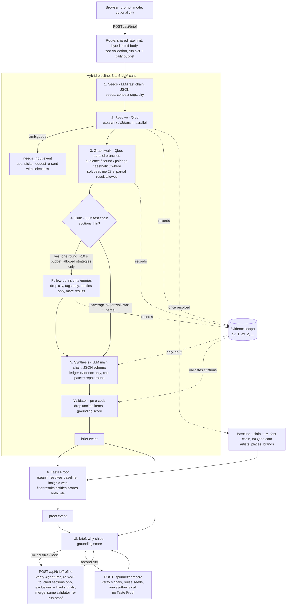

# TasteForge architecture

One Next.js app (App Router, TypeScript, Node runtime). The browser posts a request, the server runs a hybrid pipeline and streams progress and results back as Server-Sent Events.

Core rule: **the LLM translates, Qloo decides.** The LLM turns text into Qloo queries and Qloo results into prose. It never supplies a recommendation. Everything it writes must cite evidence ids from a ledger of real Qloo results, and a pure validator removes anything that does not.

## Pipeline



The baseline LLM call starts as soon as the seeds have resolved (a run that stops with `needs_input` never starts it), so Taste Proof only waits on scoring. A proof failure or timeout (12 s) never fails the brief. The comparison route runs the pipeline with the first run's resolved signals and skips extraction, resolution and the proof.

## Stages in detail

| Stage | Who | What | Failure behaviour |
|---|---|---|---|
| seeds | fast-chain LLM, JSON | Extract named entities (never invented), 2 to 6 concept phrases, city, audience hint | Unusable JSON falls back to using the prompt text as a tag query; provider errors propagate |
| resolve | code, Qloo | `/search` per seed (typed first, then untyped), `/v2/tags` per concept, all in parallel. Exact name matches win; mixed-type matches become `needs_input`. When the user answers, the chosen ids go straight into the signals (and nobody is asked twice) | Nothing resolved: look the prompt up as a tag; still nothing: friendly non-retryable error |
| walk | code, Qloo | One parallel branch per section (see below). Qloo requests are hedged: a call still unanswered after 8 s gets one duplicate request, the first answer wins, and each request times out at 15 s | Failed calls are recorded as unusable evidence; the run fails only if nothing usable came back. A **soft deadline of 28 s** after the walk starts (shorter on a short run deadline) ends the data gathering: optional calls get 4 s more, calls still in flight are reported as `ok: false` with a summary starting "Left out:", the stage detail says "partial", the critic is skipped ("skipped, out of time") and the brief is written from what arrived, with lower section confidence |
| critic | fast-chain LLM, JSON | Sees per-section coverage (calls usable, items, failures); picks up to 3 follow-ups from a fixed menu. **One round** with a budget of about 10 s (at most a quarter of the time left); skipped when no section is thin or the walk was partial | A failing or late critic is ignored |
| synthesis | main-chain LLM, JSON schema | Writes the brief from usable ledger records, citing `ev_N` ids. The palette is 4 to 5 swatches: `label` is a real colour name ("Clay terracotta"), `tags` are the Qloo decor or ambience tags it came from (shown as a caption), `role` marks the accent. A pure check (`agent/palette.ts`) asks for one repair round when the colours are near-identical, have no clear accent or are named after tags | One repair round on invalid output or a poor palette; the first valid draft is kept if the repair fails |
| validate | pure code | Strip items without valid citations, compute grounding score, attach per-section confidence | Cannot fail |
| proof | code, Qloo + baseline | See README | Returns "unavailable", brief unaffected |

### Graph walk per section

| Section | Qloo calls |
|---|---|
| audience | `/v2/insights` movie (8), tv_show (6), `urn:demographics` |
| sound | `/v2/insights` artist (10), then `/v2/trending` for the top 3 artists |
| pairings | `/v2/insights` brand (10); cuisine tags of the top places |
| aesthetic | `/v2/insights` place in the city (10); `urn:tag` analysis of the top 5 places, filtered to decor and ambience tag types |
| where | `/v2/insights` `urn:heatmap` in the city; coordinate-only hotspots get a neighbourhood name via reverse geocoding (live mode only) |

Place-based sections run only when a city is known.

## SSE event contract

`POST /api/brief`, `POST /api/brief/refine` and `POST /api/brief/compare` respond with `text/event-stream`. Each frame is `event: <type>` then `data: <json>` (the JSON repeats `type`). The stream always ends with `done`. Types are defined in `src/lib/agent/events.ts`.

| Event | Payload | Meaning |
|---|---|---|
| `stage` | `stage`: `seeds` \| `resolve` \| `walk` \| `critic` \| `synthesis` \| `proof`; `status`: `start` \| `done`; `detail?` | Progress through the pipeline. Degradation shows in `detail`: the walk says "partial: N calls cut off", the critic "skipped, out of time". The UI shows these as quiet notes, not failures |
| `thinking` | `text` | Free-text note; reserved, the pipeline no longer emits it |
| `tool_call` | `id` (`p_N` in the pipeline), `name`, `args` | A Qloo call started; drives the live graph-walk trail |
| `tool_result` | `id`, `name`, `ok`, `summary`, `evidenceId?`, `durationMs?` | The call finished; `evidenceId` links it to the ledger; `durationMs` is the wall time including queueing (shown subtly in the trail). `ok: false` with a summary starting "Left out:" means the call was dropped to stay on time: the UI shows it as skipped, not as an error |
| `needs_input` | `question`, `options[]` of `{label, qlooId, kind}` | Ambiguous seed; the client re-sends the request with `selections` |
| `brief` | `brief`, `dropped[]`, `evidence[]`, `signals?`, `signatures?` | The validated brief, what was removed and why, the ledger records it cites, the resolved taste signals (echoed back on refine and compare) and the server's HMAC signatures over both (also echoed back; `records`, `shared`, `signals`) |
| `proof` | `proof`: `{baseline[], tasteforge[], baselineAvg, tasteforgeAvg, baselineNotFound, city?}` (picks may carry `evidence[]`, `address`, `local`)` | Taste Proof; averages are `null` when nothing could be scored |
| `error` | `message`, `retryable` | User-safe failure |
| `done` | `ok` | Final frame; `ok: false` also follows `needs_input` and `error` |

Request bodies:

- `/api/brief`: `{ prompt (3-1000 chars), mode: "know_audience" | "find_audience", city?, selections? }`, max 4 KB.
- `/api/brief/refine`: `{ prompt, mode, city?, brief, evidence, signals?, signatures: { records, signals? }, feedback: { liked[], disliked[], locked[] } }`, max 200 KB. The client holds the state, so the server stays stateless. Every evidence record (and the signals) must match a signature the server issued, otherwise the request is rejected with 400.
- `/api/brief/compare`: `{ prompt, mode, city (the second city), signals?, signatures?: { signals } }`, max 6 KB. Reruns the pipeline for the new city with the first run's signals; the stream has the same events as a normal run but no `proof` (the proof stage is skipped).
- `POST /api/verify`: `{ evidence[], signatures }` returns `{ verified: boolean }`; used by `/b#...` pages to show the verified or unverified banner.
- `GET /api/showcase` returns `{ items[] }` with status `queued` | `generating` | `ready` | `failed`; the UI polls until nothing is pending. `?retry=1` clears failure back-off.
- `GET /api/health`: liveness and configuration summary for the container platform. Returns 200 when the environment is valid and 503 when it is misconfigured, so a fresh Render deploy fails its health check until the keys are set.

Errors before streaming starts are JSON: 400 (invalid body, or evidence that fails its signature), 413 (body over the limit, rejected on `Content-Length` before reading and cut off at the limit while streaming), 429 with `Retry-After` (rate limit, shared by brief, refine and compare), 503 (server not configured, or the demo is busy / out of its daily LLM budget; with `Retry-After`).

## Module map

```
src/
  app/
    page.tsx, layout.tsx, globals.css
    api/brief/route.ts            SSE brief endpoint (parse spec only; scaffolding in lib/http/streamRoute.ts)
    api/brief/refine/route.ts     SSE refine endpoint (verifies evidence signatures)
    api/brief/compare/route.ts    SSE two-city comparison endpoint (verifies signal signatures)
    api/verify/route.ts           share-link evidence check
    api/showcase/route.ts         cached example briefs (signed), rate-limited retry
    api/health/route.ts           liveness and configuration check (503 when misconfigured)
    b/page.tsx                    read-only shared brief with the verified / unverified banner
  lib/
    qloo/                         typed client for the Qloo API
      query.ts                    pure request builders, asserted param names
      client.ts                   fetch, timeout, error mapping, LRU cache, mock switch
      normalize.ts, types.ts, errors.ts, config.ts, cache.ts
      mock.ts, fixtures/          synthetic data only
    llm/                          provider adapters
      gemini.ts, groq.ts          JSON mode with schema; minimal Gemini thinking; Groq reasoning_effort low
      retry.ts, cache.ts          backoff, prompt-hash response cache
      config.ts, cascade.ts       LLM_CHAIN_FAST / LLM_CHAIN_MAIN parsing; ordered fallback with shared cooldowns
      index.ts                    routes each request to the fast or main cascade (route, else tier)
      scripted.ts, mock.ts        offline providers for E2E and tests
    agent/
      pipeline/                   seeds, resolve, walk, critic, synthesis, confidence, context
      ledger.ts                   evidence records
      validator.ts                citation check, grounding score
      brief.ts                    zod schema for the brief
      proof.ts, generate.ts       Taste Proof and the pipeline-plus-proof entry point
      palette.ts                  pure palette quality check (named colours, clear accent) for the repair round
      benchmark.ts, benchmarkReport.ts   pure helpers and the report renderer for docs/BENCHMARK.md
      refine/                     plan, synthesis, merge, request schema
      events.ts, request.ts       SSE event types and request parsing
      compare/                    second-city run and its request schema
      fence.ts                    `<<< >>>` fencing of user text in prompts
      tools.ts                    Qloo call definitions and executor used by the graph walk
    geo/                          Nominatim reverse geocoder (live mode only; coordinates clamped)
    http/
      streamRoute.ts              shared route scaffolding: rate limit, body, parse, verify, deps, budget, SSE
      request.ts                  client address, byte-limited JSON body
      guards.ts, budget.ts        shared limiters; concurrency cap and daily LLM budget
      deps.ts                     process-wide LLM and Qloo clients (caches shared across requests)
      verifyRoute.ts, sse.ts      /api/verify handler; stream plumbing
    security/
      ledgerSig.ts                HMAC signing and verification (LEDGER_SECRET)
      verifyRequest.ts            signature checks for refine and compare bodies
    singleton.ts, log.ts          globalThis singletons; server-side warnings
    rateLimit.ts                  in-memory sliding window
    showcase.ts                   pre-generated briefs, spacing and back-off
  components/                     BriefView, WhyChip, EvidenceDrawer, TasteProofPanel,
                                  ItemFeedback, RefineBar, HotspotMap, WalkView, Stages,
                                  ShowcaseGallery, Compose, TasteForgeApp
  ui/                             UI contract types, SSE client, run state, hotspots
scripts/smoke.mts                 real LLM + mock Qloo end to end
scripts/benchmark.mts             fabrication benchmark (npm run benchmark), writes docs/BENCHMARK.md
scripts/llm-bench.mts             replays captured requests against models (npm run bench:llm)
e2e/                              Playwright flows: brief, refine, share, compare
```

## Design decisions

| Decision | Reason |
|---|---|
| Hybrid pipeline instead of a free tool-calling loop | The first version let the model choose every call: 10 to 15 LLM calls per brief, slow, and it exhausted free-tier rate limits. The walk is predictable, so code runs it in parallel and the LLM is used for seeds, the critic and writing (3 to 5 calls). The old loop (`run.ts`, its prompts and the LLM `chat()` tool-calling path) has been deleted; `tools.ts` keeps only the Qloo call definitions the walk uses. |
| Evidence ledger plus validator | "Grounded" has to be checkable. Citations are ids that either exist in the ledger or do not, so the score is computed by code, not claimed by the model. |
| Dropped items lower the score | Hiding failures would make the score meaningless. |
| Critic limited to a fixed menu of strategies | The model can improve thin coverage but cannot invent queries; off-menu or repeated follow-ups are discarded. Capped at 2 rounds. |
| Ask when a name is ambiguous | A wrong guess at the seed poisons every downstream call. A one-click question is cheaper. Showcases and smoke runs auto-pick instead. |
| Taste Proof uses `filter.results.entities` | Qloo scores a supplied shortlist, so both lists are judged by the same function on the same signals. Unfound picks are reported, not scored as zero. |
| Fast and main LLM chains | Each call type has its own ordered chain: `LLM_CHAIN_FAST` for the short calls (seeds, critic, Taste Proof baseline), `LLM_CHAIN_MAIN` for the brief synthesis. Measured on 2026-10-20 (see "Speed pass" below), Groq answers the short calls in 0.4 to 1 s and the synthesis in 5 to 6 s, where Gemini's free tier needs 9 to 21 s and 13 to 16 s, so Groq leads both chains and Gemini is the deeper fallback. The baseline is a plain LLM either way: speed does not change its role as the opponent. |
| Model cascades (`LLM_CHAIN_FAST` / `LLM_CHAIN_MAIN`), JSON response cache | Keeps the demo alive on free tiers. Models are tried in order and the two chains share their cooldowns; one that returns 429, quota exhausted or 503 cools down (until 00:00 UTC for daily quotas, else the retry-after) and is skipped, so a failed request is not paid per brief. The answering model is recorded in `brief.model`. The LLM and Qloo clients (and their caches) are created once per process, so repeat requests actually hit the caches. The Qloo client keeps at most 4 requests in flight with a 250 ms gap between starts (the hackathon key answers 429 for bursts), and retries with jitter on 429 (twice), 5xx and timeouts (once). |
| Stateless server; client echoes brief, evidence and signals on refine | No database, nothing to leak, nothing to clean up. Bodies are schema-validated and size-capped. |
| HMAC-signed evidence ledger (`LEDGER_SECRET`) | The browser holds the evidence between calls, so without a signature it could forge "Qloo data" for refine, compare or a shared link. Each record and the signal set are signed per record; a second signature covers the slimmed form share links carry. Shared pages verify through `/api/verify` and say so. The signature covers the evidence, not the prose of the brief. |
| One shared limiter, run cap and daily LLM budget | Separate per-route limiters tripled a visitor's allowance. One allowance, a cap on concurrent runs and a daily call budget keep a public demo inside free-tier quotas, and the failure is a friendly, retryable "busy" message. |
| User text fenced in prompts, Qloo ids validated | Prompt-injection hygiene: fenced fields plus an instruction to treat them as data; ids from the browser must match Qloo's id formats before they reach a query string. |
| Refine re-walks only touched sections | Faster and keeps liked and locked items verbatim. Dislikes become `filter.exclude.*`; likes are added as signals. The heatmap has no exclude parameter, so disliked cells are filtered after the call. |
| Showcase briefs pre-generated, one at a time with spacing | Judges get an instant first result even when the LLM tier is throttled. Cached in memory and in a git-ignored directory only. |
| Mock Qloo and scripted LLM | The whole app, tests and E2E run offline. The switch to live data is one env var. |
| Pure query builders with exact-parameter tests | Qloo ignores unknown parameters silently, so a typo produces plausible but wrong results. Tests assert the query strings. |
| Pipeline deadline (90 s) shared by every LLM call, a 28 s walk soft deadline inside it | Keeps the SSE request inside the 120 s function limit (the proof gets 25 s more) and ends in a friendly retryable error instead of a hang. The soft deadline trades completeness for time: a slow Qloo tail yields a partial, lower-confidence brief rather than a late one. |
| Immutable data, small modules | Records and briefs are never mutated in place; most files are well under 400 lines. |

## Speed pass (2026-10-20)

Where the time went: Qloo calls are 1 to 10 s each with a tail past 30 s, and on Gemini's free tier the LLM calls took 9 to 21 s for the seeds and about 37 s for the synthesis, with 503s forcing fallbacks. Four changes:

1. **One round of the critic, about 10 s** (it used to run up to two), skipped when the walk was partial.
2. **A 28 s soft deadline on the walk.** Slow Qloo calls are reported as "Left out:" and the brief is written from what arrived (see the stage table). Partial briefs show lower section confidence.
3. **Hedged Qloo requests** (a duplicate after 8 s, 15 s timeout), plus `durationMs` on every `tool_result` so slow calls are visible.
4. **Per-call-type LLM chains**, chosen by measurement (below), and minimal Gemini thinking for both tiers.

### LLM measurements

Replayed the real requests of live-Qloo runs (Indore cafe, London ceramic artist) against each model, 2 to 4 runs each. Gemini thinking was at its minimum (`thinkingLevel: minimal` on 3.x, budget 0 on 2.5); Groq `reasoning_effort` low (`none` for Qwen).

| Call | Model | Latency | Valid JSON | Notes |
|---|---|---|---|---|
| seeds | Groq gpt-oss-120b | 0.6 to 1.0 s | 4 of 4 | only model that added the brand seeds that `find_audience` asks for |
| seeds | Groq gpt-oss-20b | 0.4 to 0.7 s | 4 of 4 | no brand seeds |
| seeds | Groq qwen3.8-27b | 0.3 to 0.7 s | 4 of 4 | no brand seeds |
| seeds | Gemini 3.5 Flash-Lite | 20.5 s | 1 of 3 | two HTTP 503 |
| synthesis | Groq gpt-oss-120b | 4.7 to 6.3 s | 4 of 4 | grounding 100%, 3 to 5 artists, 2 to 4 places |
| synthesis | Groq gpt-oss-20b | 1.8 to 2.1 s | 1 of 2 | one reply had the wrong shape |
| synthesis | Groq qwen3.8-27b | 4.4 to 4.6 s | 2 of 2 | thinner lists (2 to 3 artists, 0 to 3 places) |
| synthesis | Gemini 2.5 Flash | 12.9 to 15.7 s | 2 of 2 | richest lists |
| synthesis | Gemini 3.5 Flash | 13.7 s | 1 of 2 | one HTTP 503 |
| synthesis | Gemini 3.5 Flash-Lite | none | 0 of 5 | HTTP 503 or a 60 s timeout every time |

Routing that follows: `LLM_CHAIN_FAST` (seeds, critic, Taste Proof baseline) starts with gpt-oss-120b, then qwen3.8-27b and gpt-oss-20b, with Gemini 2.5 Flash and 3.5 Flash-Lite behind. `LLM_CHAIN_MAIN` (synthesis) starts with gpt-oss-120b, then Gemini 2.5 Flash (full quality), qwen, the other Gemini models, and gpt-oss-20b last. Groq's free tier allows 8000 tokens a minute per model and one brief needs about 11,000 across its calls, so a second brief within the same minute gets a 429 on gpt-oss-120b and falls through the chain; the chains share cooldowns so the failed model is skipped meanwhile. The compact synthesis prompt (fewer items, no notes, no schema descriptions) keeps one synthesis request under the cap.

### End to end, live Qloo and real LLM

| | Brief on screen | Whole run incl. Taste Proof | LLM calls |
|---|---|---|---|
| Before (Gemini-first chain, same code, Indore cafe) | 47.4 s (seeds 15.7 s, synthesis 22 s, two 503 fallbacks) | 49.4 s | 5 |
| After (5 runs: Indore, London twice, Brooklyn, Chicago) | median 16.1 s, 14.0 to 45.3 s | median 38.4 s, 15.0 to 61.1 s | 3 to 6 |

The slow "after" runs are Qloo walk tails (27 to 30 s to the soft deadline) and, for the proof, one Qloo place-scoring request that timed out at 15 s. The LLM share of a run is now about 7 s.
