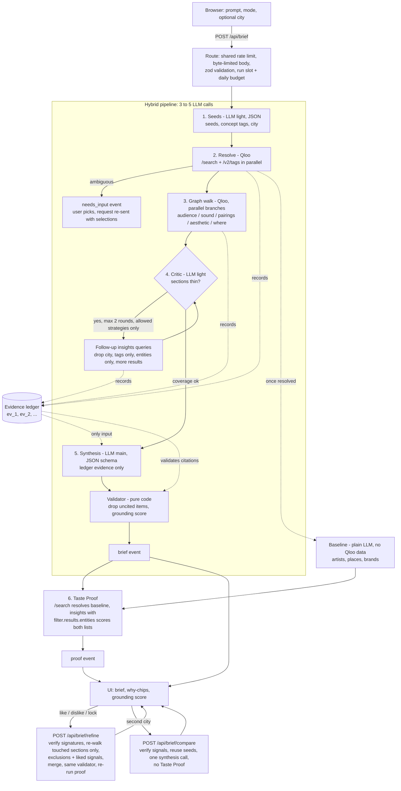

# TasteForge architecture

One Next.js app (App Router, TypeScript, Node runtime). The browser posts a request, the server runs a hybrid pipeline and streams progress and results back as Server-Sent Events.

Core rule: **the LLM translates, Qloo decides.** The LLM turns text into Qloo queries and Qloo results into prose. It never supplies a recommendation. Everything it writes must cite evidence ids from a ledger of real Qloo results, and a pure validator removes anything that does not.

## Pipeline



The baseline LLM call starts as soon as the seeds have resolved (a run that stops with `needs_input` never starts it), so Taste Proof only waits on scoring. A proof failure or timeout (12 s) never fails the brief. The comparison route runs the pipeline with the first run's resolved signals and skips extraction, resolution and the proof.

## Stages in detail

| Stage | Who | What | Failure behaviour |
|---|---|---|---|
| seeds | light LLM, JSON | Extract named entities (never invented), 2 to 6 concept phrases, city, audience hint | Unusable JSON falls back to using the prompt text as a tag query; provider errors propagate |
| resolve | code, Qloo | `/search` per seed (typed first, then untyped), `/v2/tags` per concept, all in parallel. Exact name matches win; mixed-type matches become `needs_input`. When the user answers, the chosen ids go straight into the signals (and nobody is asked twice) | Nothing resolved: look the prompt up as a tag; still nothing: friendly non-retryable error |
| walk | code, Qloo | One parallel branch per section (see below) | Failed calls are recorded as unusable evidence; the run fails only if nothing usable came back |
| critic | light LLM, JSON | Sees per-section coverage (calls usable, items, failures); picks up to 3 follow-ups per round from a fixed menu, max 2 rounds; skipped when no section is thin | A failing critic is ignored |
| synthesis | main LLM, JSON schema | Writes the brief from usable ledger records, citing `ev_N` ids | Schema repair on invalid output |
| validate | pure code | Strip items without valid citations, compute grounding score, attach per-section confidence | Cannot fail |
| proof | code, Qloo + baseline | See README | Returns "unavailable", brief unaffected |

### Graph walk per section

| Section | Qloo calls |
|---|---|
| audience | `/v2/insights` movie (8), tv_show (6), `urn:demographics` |
| sound | `/v2/insights` artist (10), then `/v2/trending` for the top 3 artists |
| pairings | `/v2/insights` brand (10); cuisine tags of the top places |
| aesthetic | `/v2/insights` place in the city (10); `urn:tag` analysis of the top 5 places, filtered to decor and ambience tag types |
| where | `/v2/insights` `urn:heatmap` in the city; coordinate-only hotspots get a neighbourhood name via reverse geocoding (live mode only) |

Place-based sections run only when a city is known.

## SSE event contract

`POST /api/brief`, `POST /api/brief/refine` and `POST /api/brief/compare` respond with `text/event-stream`. Each frame is `event: <type>` then `data: <json>` (the JSON repeats `type`). The stream always ends with `done`. Types are defined in `src/lib/agent/events.ts`.

| Event | Payload | Meaning |
|---|---|---|
| `stage` | `stage`: `seeds` \| `resolve` \| `walk` \| `critic` \| `synthesis` \| `proof`; `status`: `start` \| `done`; `detail?` | Progress through the pipeline |
| `thinking` | `text` | Free-text note; reserved, the pipeline no longer emits it |
| `tool_call` | `id` (`p_N` in the pipeline), `name`, `args` | A Qloo call started; drives the live graph-walk trail |
| `tool_result` | `id`, `name`, `ok`, `summary`, `evidenceId?` | The call finished; `evidenceId` links it to the ledger |
| `needs_input` | `question`, `options[]` of `{label, qlooId, kind}` | Ambiguous seed; the client re-sends the request with `selections` |
| `brief` | `brief`, `dropped[]`, `evidence[]`, `signals?`, `signatures?` | The validated brief, what was removed and why, the ledger records it cites, the resolved taste signals (echoed back on refine and compare) and the server's HMAC signatures over both (also echoed back; `records`, `shared`, `signals`) |
| `proof` | `proof`: `{baseline[], tasteforge[], baselineAvg, tasteforgeAvg, baselineNotFound, city?}` (picks may carry `evidence[]`, `address`, `local`)` | Taste Proof; averages are `null` when nothing could be scored |
| `error` | `message`, `retryable` | User-safe failure |
| `done` | `ok` | Final frame; `ok: false` also follows `needs_input` and `error` |

Request bodies:

- `/api/brief`: `{ prompt (3-1000 chars), mode: "know_audience" | "find_audience", city?, selections? }`, max 4 KB.
- `/api/brief/refine`: `{ prompt, mode, city?, brief, evidence, signals?, signatures: { records, signals? }, feedback: { liked[], disliked[], locked[] } }`, max 200 KB. The client holds the state, so the server stays stateless. Every evidence record (and the signals) must match a signature the server issued, otherwise the request is rejected with 400.
- `/api/brief/compare`: `{ prompt, mode, city (the second city), signals?, signatures?: { signals } }`, max 6 KB. Reruns the pipeline for the new city with the first run's signals; the stream has the same events as a normal run but no `proof` (the proof stage is skipped).
- `POST /api/verify`: `{ evidence[], signatures }` returns `{ verified: boolean }`; used by `/b#...` pages to show the verified or unverified banner.
- `GET /api/showcase` returns `{ items[] }` with status `queued` | `generating` | `ready` | `failed`; the UI polls until nothing is pending. `?retry=1` clears failure back-off.
- `GET /api/health`: liveness and configuration summary for the container platform. Returns 200 when the environment is valid and 503 when it is misconfigured, so a fresh Render deploy fails its health check until the keys are set.

Errors before streaming starts are JSON: 400 (invalid body, or evidence that fails its signature), 413 (body over the limit, rejected on `Content-Length` before reading and cut off at the limit while streaming), 429 with `Retry-After` (rate limit, shared by brief, refine and compare), 503 (server not configured, or the demo is busy / out of its daily LLM budget; with `Retry-After`).

## Module map

```
src/
  app/
    page.tsx, layout.tsx, globals.css
    api/brief/route.ts            SSE brief endpoint (parse spec only; scaffolding in lib/http/streamRoute.ts)
    api/brief/refine/route.ts     SSE refine endpoint (verifies evidence signatures)
    api/brief/compare/route.ts    SSE two-city comparison endpoint (verifies signal signatures)
    api/verify/route.ts           share-link evidence check
    api/showcase/route.ts         cached example briefs (signed), rate-limited retry
    api/health/route.ts           liveness and configuration check (503 when misconfigured)
    b/page.tsx                    read-only shared brief with the verified / unverified banner
  lib/
    qloo/                         typed client for the Qloo API
      query.ts                    pure request builders, asserted param names
      client.ts                   fetch, timeout, error mapping, LRU cache, mock switch
      normalize.ts, types.ts, errors.ts, config.ts, cache.ts
      mock.ts, fixtures/          synthetic data only
    llm/                          provider adapters
      gemini.ts, groq.ts          JSON mode with schema, light/main tiers
      retry.ts, cache.ts          backoff, prompt-hash response cache
      index.ts                    Gemini primary, Groq fallback
      scripted.ts, mock.ts        offline providers for E2E and tests
    agent/
      pipeline/                   seeds, resolve, walk, critic, synthesis, confidence, context
      ledger.ts                   evidence records
      validator.ts                citation check, grounding score
      brief.ts                    zod schema for the brief
      proof.ts, generate.ts       Taste Proof and the pipeline-plus-proof entry point
      refine/                     plan, synthesis, merge, request schema
      events.ts, request.ts       SSE event types and request parsing
      compare/                    second-city run and its request schema
      fence.ts                    `<<< >>>` fencing of user text in prompts
      tools.ts                    Qloo call definitions and executor used by the graph walk
    geo/                          Nominatim reverse geocoder (live mode only; coordinates clamped)
    http/
      streamRoute.ts              shared route scaffolding: rate limit, body, parse, verify, deps, budget, SSE
      request.ts                  client address, byte-limited JSON body
      guards.ts, budget.ts        shared limiters; concurrency cap and daily LLM budget
      deps.ts                     process-wide LLM and Qloo clients (caches shared across requests)
      verifyRoute.ts, sse.ts      /api/verify handler; stream plumbing
    security/
      ledgerSig.ts                HMAC signing and verification (LEDGER_SECRET)
      verifyRequest.ts            signature checks for refine and compare bodies
    singleton.ts, log.ts          globalThis singletons; server-side warnings
    rateLimit.ts                  in-memory sliding window
    showcase.ts                   pre-generated briefs, spacing and back-off
  components/                     BriefView, WhyChip, EvidenceDrawer, TasteProofPanel,
                                  ItemFeedback, RefineBar, HotspotMap, WalkView, Stages,
                                  ShowcaseGallery, Compose, TasteForgeApp
  ui/                             UI contract types, SSE client, run state, hotspots
scripts/smoke.mts                 real LLM + mock Qloo end to end
e2e/                              Playwright flows: brief, refine, share, compare
```

## Design decisions

| Decision | Reason |
|---|---|
| Hybrid pipeline instead of a free tool-calling loop | The first version let the model choose every call: 10 to 15 LLM calls per brief, slow, and it exhausted free-tier rate limits. The walk is predictable, so code runs it in parallel and the LLM is used for seeds, the critic and writing (3 to 5 calls). The old loop (`run.ts`, its prompts and the LLM `chat()` tool-calling path) has been deleted; `tools.ts` keeps only the Qloo call definitions the walk uses. |
| Evidence ledger plus validator | "Grounded" has to be checkable. Citations are ids that either exist in the ledger or do not, so the score is computed by code, not claimed by the model. |
| Dropped items lower the score | Hiding failures would make the score meaningless. |
| Critic limited to a fixed menu of strategies | The model can improve thin coverage but cannot invent queries; off-menu or repeated follow-ups are discarded. Capped at 2 rounds. |
| Ask when a name is ambiguous | A wrong guess at the seed poisons every downstream call. A one-click question is cheaper. Showcases and smoke runs auto-pick instead. |
| Taste Proof uses `filter.results.entities` | Qloo scores a supplied shortlist, so both lists are judged by the same function on the same signals. Unfound picks are reported, not scored as zero. |
| Light and main model tiers | Seeds and the critic use a cheaper model with higher free-tier limits; synthesis and the baseline use the main model. The baseline needs to be a fair opponent. |
| Model cascade (`LLM_CHAIN`), JSON response cache | Keeps the demo alive on free tiers. Models are tried in order; one that returns 429, quota exhausted or 503 cools down (until 00:00 UTC for daily quotas, else the retry-after) and is skipped, so a failed request is not paid per brief. The answering model is recorded in `brief.model`. The LLM and Qloo clients (and their caches) are created once per process, so repeat requests actually hit the caches. The Qloo client keeps at most 4 requests in flight with a 250 ms gap between starts (the hackathon key answers 429 for bursts), and retries with jitter on 429 (twice), 5xx and timeouts (once). |
| Stateless server; client echoes brief, evidence and signals on refine | No database, nothing to leak, nothing to clean up. Bodies are schema-validated and size-capped. |
| HMAC-signed evidence ledger (`LEDGER_SECRET`) | The browser holds the evidence between calls, so without a signature it could forge "Qloo data" for refine, compare or a shared link. Each record and the signal set are signed per record; a second signature covers the slimmed form share links carry. Shared pages verify through `/api/verify` and say so. The signature covers the evidence, not the prose of the brief. |
| One shared limiter, run cap and daily LLM budget | Separate per-route limiters tripled a visitor's allowance. One allowance, a cap on concurrent runs and a daily call budget keep a public demo inside free-tier quotas, and the failure is a friendly, retryable "busy" message. |
| User text fenced in prompts, Qloo ids validated | Prompt-injection hygiene: fenced fields plus an instruction to treat them as data; ids from the browser must match Qloo's id formats before they reach a query string. |
| Refine re-walks only touched sections | Faster and keeps liked and locked items verbatim. Dislikes become `filter.exclude.*`; likes are added as signals. The heatmap has no exclude parameter, so disliked cells are filtered after the call. |
| Showcase briefs pre-generated, one at a time with spacing | Judges get an instant first result even when the LLM tier is throttled. Cached in memory and in a git-ignored directory only. |
| Mock Qloo and scripted LLM | The whole app, tests and E2E run offline. The switch to live data is one env var. |
| Pure query builders with exact-parameter tests | Qloo ignores unknown parameters silently, so a typo produces plausible but wrong results. Tests assert the query strings. |
| Pipeline deadline (60 s) shared by every LLM call | Keeps the SSE request inside the 120 s function limit and ends in a friendly retryable error instead of a hang. |
| Immutable data, small modules | Records and briefs are never mutated in place; most files are well under 400 lines. |
